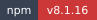
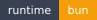
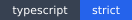
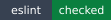
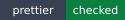
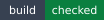
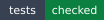

<!-- markdownlint-disable MD013 MD033 -->
<!-- This file is generated by Paradox. Do not edit manually. -->

# @ankhorage/studio

        

Studio authoring package for Ankhorage apps

## Usage

### CLI

Ankhorage packages expose their command-line interface through `ankh`. Use `ankh --help` to discover available package commands, or run a package command with `--help` for package-specific usage.

```zsh
# Install the Ankhorage CLI
bun add --global @ankhorage/ankh

# Show usage information for studio
ankh studio --help
```

### Canvas drag payload

Create and validate the payload used while dragging a Studio canvas node.

Run with `bun examples/canvas-drag-payload/basic.ts` after building the package.

```ts
import {
  createStudioCanvasDragPayload,
  isStudioCanvasDragPayload,
} from '@ankhorage/studio/canvasDragModel';
```

## Documentation

Open `./paradox/index.html` locally in your browser to browse the complete documentation.

## Contributors

<!-- readme: contributors -start -->
<!-- readme: contributors -end -->

## Donation

If this project is useful to you, you can support its continued development.

[Support @ankhorage](https://github.com/sponsors/ankhorage)
